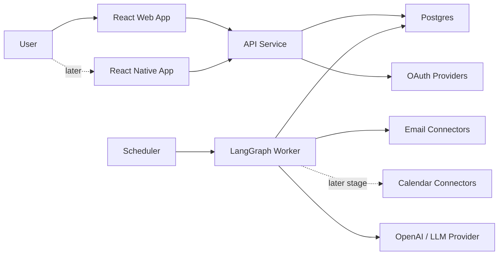

# Architecture

## Proposal Status

The Version 0 checkpoint is merged; documentation reconciliation is complete. [Decision 0005](decisions/0005-preserve-selected-component-direction.md) records the selected React web, React Native later, backend API, and Postgres direction. Backend framework, schema, authentication vendor, hosting, and deployment topology remain undecided. Detailed architecture below is proposed, not a formal specification. Calendar components and policies are future-stage only.

## Direction

The new architecture should keep provider APIs, OAuth, persistence, and calendar writes as conventional TypeScript services. LangGraph should orchestrate the decision workflow and own the state transitions for classification, extraction, validation, approval, and digest inclusion.

The product should be designed as a full-stack application with these minimum major components:

- A React web application for the first user-facing surface.
- A React Native mobile application, added after the web experience establishes the core workflows.
- A backend API service for accounts, provider connections, preferences, digests, and review flows.
- A Postgres database for product state, provider metadata, graph state, extracted items, and audit records.

The web app should come first to simplify early development, static UI mocks, and browser-based validation. The mobile app should reuse the same API and product model rather than becoming a separate product.

## Selected Components And Proposed Responsibilities

### React Web App

Initial user-facing client for setup, source approval, child/topic configuration, digest review, and later review queues.

Responsibilities:

- Account connection entry points
- Trusted source approval
- Child and topic configuration
- Daily digest review
- Explanation and audit views
- Static HTML mock parity for harness validation

### React Native Mobile App

Mobile client for the same core workflows once the web product is stable.

Responsibilities:

- Digest reading and lightweight review
- Approval actions for future calendar candidates
- Push-notification-oriented workflows when those become part of the product
- Shared API contracts with the web app

### API Service

Primary user-facing backend for accounts, providers, profiles, preferences, review queues, and digest views.

Responsibilities:

- OAuth initiation and callback handling
- Account, child, source, topic, and policy configuration
- Review and feedback APIs
- Digest read APIs
- Calendar connection management in the future calendar stage

The backend framework should be chosen for the fresh implementation rather than inherited by default.

### Provider Connectors

Provider connectors should hide Gmail, Outlook, Google Calendar, and Outlook Calendar details behind stable interfaces.

Email connector responsibilities:

- Fetch account identity
- List recent senders
- Fetch messages by cursor/date/source filters
- Normalize provider message metadata
- Expose immutable provider IDs for deduplication

Calendar connector responsibilities:

- Create events
- Update events
- Search likely duplicates
- Store provider event IDs

### Graph Worker

The graph worker runs LangGraph workflows for owner-triggered email processing and digest refresh.

Responsibilities:

- Load message and account context
- Classify source, child, and topic
- Extract digest actions, deadlines, and event details; formal candidates are future-stage only
- Validate and route decisions
- Pause for approval when policy requires it
- Persist graph state and outputs
- In the future calendar stage, schedule writes through provider services

Whether the graph initially runs inside the API or a separate worker is undecided. Keep that boundary movable.

### Persistence Layer

Postgres is the selected backing store. Tables should be designed around the fresh product model.

Persistence should cover:

- Accounts and users
- Connected inboxes and calendars
- Trusted sources
- Children
- Topics and topic rules
- Email metadata and normalized content
- Graph runs and node outputs
- Extracted items
- Event candidates and calendar event links
- Digest items
- User feedback

### Background Processing

The first release polls the connected inbox every four hours and also supports owner-triggered checks. Selecting `Check for updates` should enqueue or run the inbox synchronization and digest refresh workflow immediately. The polling interval should be operationally configurable. Provider webhooks and scheduled digest delivery are not required.

Background processing should trigger the agreed polling cadence and handle bounded retries. Later releases may add:

- Automatic checks when the app opens
- Higher-frequency polling or provider webhooks
- Notification delivery

## Provider Boundary

Use provider-neutral interfaces in the graph state. Provider-specific message and event payloads should be transformed before the graph sees them.

Application code, not an AI agent, should access user email and calendar accounts. OAuth credentials, provider cursors, mailbox queries, and calendar write APIs belong behind typed service boundaries controlled by the backend. The AI workflow should receive only normalized, scoped content that the application has already selected for analysis.

Example email message shape:

```ts
interface NormalizedEmail {
  accountId: string;
  inboxId: string;
  provider: "OUTLOOK" | "GMAIL";
  providerMessageId: string;
  threadId?: string;
  subject: string;
  from: EmailAddress;
  to: EmailAddress[];
  sentAt: string;
  receivedAt?: string;
  textBody: string;
  htmlBody?: string;
  sourceUrl?: string;
}
```

## AI Boundary

Model calls should be small, typed, and auditable. Each call should produce structured data with confidence, evidence, and uncertainty fields.

### Future Relevance Screening

After the baseline workflow is working and measured, evaluate Jev as a low-cost screening stage before the more capable analysis model. Jev can test normalized email content against the user's preferred categories and return category-level probabilities. Likely matches should continue to the main LangGraph analysis workflow.

This is an optimization hypothesis, not a requirement for the first implementation. The screening stage must be validated against labeled email fixtures before it can suppress downstream model calls. It should be tuned for high recall, route uncertain or borderline messages onward, and retain its scores and routing decision for audit and regression testing. Relevant messages must not disappear solely because a low-cost classifier made an opaque negative decision.

Evaluation should compare:

- Recall for relevant messages, including messages relevant to only one configured child.
- False-negative rates by source and preferred category.
- Cost and latency per processed email.
- The percentage of messages routed to the more capable model.
- Behavior when preferences are sparse, overlapping, or newly changed.

Avoid:

- One giant prompt that classifies, extracts, validates, and decides calendar writes.
- Giving an AI agent direct access to a user's email account, mailbox search tools, OAuth credentials, or calendar APIs.
- Model-written calendar API payloads without deterministic validation.
- Model decisions that cannot be traced back to source text.

Prefer:

- Backend-owned provider connectors that fetch and scope email content before model analysis.
- Focused schemas per node.
- Deterministic validators after model extraction.
- Saved input/output for debugging and regression tests.
- Human approval routes for ambiguous or high-impact actions.

## Deployment Shape

One proposed deployment is a single API service plus Postgres; deployment topology is undecided. Calendar connectors in this diagram are future-stage only:



As usage grows, split the graph worker into its own process with a queue.

## Implementation Principles

- Start with read-only ingestion before calendar writes.
- Make calendar writes approval-gated until validation and deduplication are proven.
- Store enough graph state to explain every digest and event decision.
- Keep provider credentials separate from graph state.
- Treat source trust, topic preference, and calendar policy as user-owned configuration.
