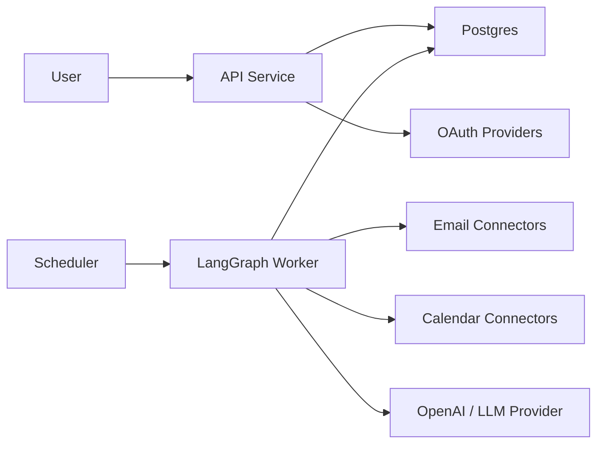

# Architecture

## Direction

The new architecture should keep provider APIs, OAuth, persistence, and calendar writes as conventional TypeScript services. LangGraph should orchestrate the decision workflow and own the state transitions for classification, extraction, validation, approval, and digest inclusion.

## Proposed System Components

### API Service

Primary user-facing backend for accounts, providers, profiles, preferences, review queues, and digest views.

Responsibilities:

- OAuth initiation and callback handling
- Account, child, source, topic, and policy configuration
- Review and feedback APIs
- Digest read APIs
- Calendar connection management

The backend framework should be chosen for the fresh implementation rather than inherited by default.

### Provider Connectors

Provider connectors should hide Gmail, Outlook, Google Calendar, and Outlook Calendar details behind stable interfaces.

Email connector responsibilities:

- Fetch account identity
- List recent senders
- Fetch messages by cursor/date/source filters
- Normalize provider message metadata
- Expose immutable provider IDs for deduplication

Calendar connector responsibilities:

- Create events
- Update events
- Search likely duplicates
- Store provider event IDs

### Graph Worker

The graph worker runs LangGraph workflows for email processing and daily digest generation.

Responsibilities:

- Load message and account context
- Classify source, child, and topic
- Extract actions, deadlines, and event candidates
- Validate and route decisions
- Pause for approval when policy requires it
- Persist graph state and outputs
- Schedule calendar writes through provider services

This can live inside the API service at first, but the graph should be packaged so it can later move into a worker process.

### Persistence Layer

Postgres remains the likely backing store. Tables should be designed around the fresh product model.

Persistence should cover:

- Accounts and users
- Connected inboxes and calendars
- Trusted sources
- Children
- Topics and topic rules
- Email metadata and normalized content
- Graph runs and node outputs
- Extracted items
- Event candidates and calendar event links
- Digest items
- User feedback

### Scheduler

The scheduler triggers:

- Periodic email polling until provider webhooks are added
- Daily digest generation
- Retry of transient provider/model failures

Provider webhooks can be added after the core graph is stable.

## Provider Boundary

Use provider-neutral interfaces in the graph state. Provider-specific message and event payloads should be transformed before the graph sees them.

Example email message shape:

```ts
interface NormalizedEmail {
  accountId: string;
  inboxId: string;
  provider: "OUTLOOK" | "GMAIL";
  providerMessageId: string;
  threadId?: string;
  subject: string;
  from: EmailAddress;
  to: EmailAddress[];
  sentAt: string;
  receivedAt?: string;
  textBody: string;
  htmlBody?: string;
  sourceUrl?: string;
}
```

## AI Boundary

Model calls should be small, typed, and auditable. Each call should produce structured data with confidence, evidence, and uncertainty fields.

Avoid:

- One giant prompt that classifies, extracts, validates, and decides calendar writes.
- Model-written calendar API payloads without deterministic validation.
- Model decisions that cannot be traced back to source text.

Prefer:

- Focused schemas per node.
- Deterministic validators after model extraction.
- Saved input/output for debugging and regression tests.
- Human approval routes for ambiguous or high-impact actions.

## Deployment Shape

Initial deployment can be a single API service plus Postgres:



As usage grows, split the graph worker into its own process with a queue.

## Implementation Principles

- Start with read-only ingestion before calendar writes.
- Make calendar writes approval-gated until validation and deduplication are proven.
- Store enough graph state to explain every digest and event decision.
- Keep provider credentials separate from graph state.
- Treat source trust, topic preference, and calendar policy as user-owned configuration.
