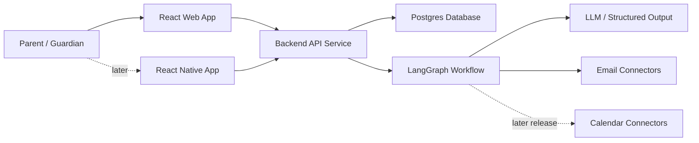

# Architecture Overview

## Current State

No application code has been implemented yet. The Version 0 checkpoint is merged and documentation reconciliation is complete. Component direction is selected; detailed architecture is provisional, not a formal contract.

## Expected System Shape

The diagram reflects selected major components: React web first, backend API, Postgres, and React Native later. See [Decision 0005](../decisions/0005-preserve-selected-component-direction.md) for the selection and genuinely undecided implementation details. Mobile delivery is outside the first release.

## Key Boundaries

- Web UI handles initial configuration, digest review, and approval flows.
- Mobile UI should reuse the same API contracts for digest reading and lightweight approval workflows.
- API handles account state, preferences, review queues, and persisted records.
- Graph handles workflow state and AI-assisted classification/extraction.
- Provider connectors hide external provider differences.
- In the first release, application services access user email accounts and AI receives normalized, scoped content for analysis rather than direct account access.
- Calendar connectors and writes are later-release capabilities and will require deterministic validation and policy checks.

## Links

- Product requirements: `docs/product-requirements.md`
- LangGraph workflows: `docs/langgraph-workflows.md`
- Data model: `docs/data-model.md`
