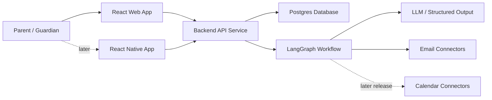

# Architecture Overview

## Current State

No application code has been implemented yet. Requirements discovery is paused at the [Version 0 trial snapshot](../product/requirements-workshop-v0.md). Architecture is documented as intended boundaries and provisional proposals, not formal contracts.

## Expected System Shape

The diagram proposes a React web frontend, backend API service, and Postgres; no application stack has been selected. React Native is a future mobile proposal, not a Version 0 requirement. These choices need reconciliation with the product boundary before formal specification.

## Key Boundaries

- Web UI handles initial configuration, digest review, and approval flows.
- Mobile UI should reuse the same API contracts for digest reading and lightweight approval workflows.
- API handles account state, preferences, review queues, and persisted records.
- Graph handles workflow state and AI-assisted classification/extraction.
- Provider connectors hide external provider differences.
- In the first release, application services access user email accounts and AI receives normalized, scoped content for analysis rather than direct account access.
- Calendar connectors and writes are later-release capabilities and will require deterministic validation and policy checks.

## Links

- Product requirements: `docs/product-requirements.md`
- LangGraph workflows: `docs/langgraph-workflows.md`
- Data model: `docs/data-model.md`
