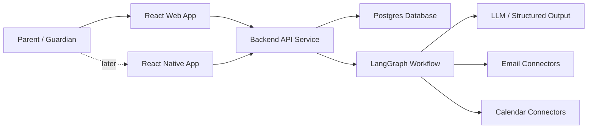

# Architecture Overview

## Current State

No application code has been implemented yet. Architecture is currently documented as intended boundaries and workflow expectations.

## Expected System Shape

At a minimum, the application should include a React web frontend, a backend API service, and Postgres. A React Native phone app is part of the intended product shape, but it can follow after the web version proves the core setup, digest, and review workflows.

## Key Boundaries

- Web UI handles initial configuration, digest review, and approval flows.
- Mobile UI should reuse the same API contracts for digest reading and lightweight approval workflows.
- API handles account state, preferences, review queues, and persisted records.
- Graph handles workflow state and AI-assisted classification/extraction.
- Provider connectors hide external provider differences.
- Application services access user email and calendar accounts; AI receives normalized, scoped content for analysis rather than direct account access.
- Calendar writes require deterministic validation and policy checks.

## Links

- Product requirements: `docs/product-requirements.md`
- LangGraph workflows: `docs/langgraph-workflows.md`
- Data model: `docs/data-model.md`
