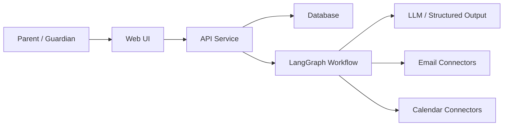

# Architecture Overview

## Current State

No application code has been implemented yet. Architecture is currently documented as intended boundaries and workflow expectations.

## Expected System Shape

## Key Boundaries

- UI handles configuration, digest review, and approval flows.
- API handles account state, preferences, review queues, and persisted records.
- Graph handles workflow state and AI-assisted classification/extraction.
- Provider connectors hide external provider differences.
- Calendar writes require deterministic validation and policy checks.

## Links

- Product requirements: `docs/product-requirements.md`
- LangGraph workflows: `docs/langgraph-workflows.md`
- Data model: `docs/data-model.md`
