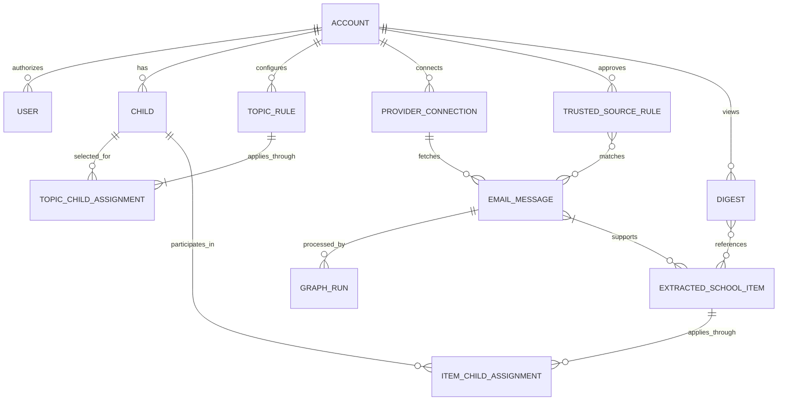

# Data Model

## Proposal Status

This inherited conceptual model is preserved for the [Version 0 trial](product/requirements-workshop-v0.md), not accepted as a formal schema. The relationship contract below reflects owner/viewer roles and multiple-child assignments. Physical tables, temporal storage, and cached digest implementation remain undecided. Calendar entities/policies are future-stage proposals; delivery fields do not imply proactive email in v1. Retention and credential storage remain unresolved.

## Proposed Core Entities

### Account

Owns users, children, sources, provider connections, topics, and digest policy.

### User

Represents an authenticated household member. The owner manages connections, configuration, and corrections; invited guardians or students are read-only viewers. Every authorized viewer can access all household and child views.

### Child

Represents a child-specific context.

Suggested fields:

- `id`
- `accountId`
- `displayName`
- `schoolName`
- `grade`
- `aliases`
- `active`

### Provider Connection

Represents an external email or calendar integration. Email and calendar connections should be separate so users can read from one provider and write events to another.

Suggested fields:

- `id`
- `accountId`
- `provider`
- `capability`: `EMAIL_READ` or `CALENDAR_WRITE`
- `email`
- `credentials`
- `status`
- `createdAt`
- `updatedAt`

### Trusted Source Rule

User-approved rule describing which senders the system may process. Rules are configured per household and may differ across schools and communication systems.

Suggested fields:

- `id`
- `accountId`
- `providerConnectionId`
- `type`: `EMAIL_ADDRESS` or `DOMAIN` initially; future evidence may add `ADDRESS_PATTERN` or `STABLE_SENDER_ID`
- `value`
- `displayName`
- `scopeLabel`: user-facing school, district, or platform context
- `status`: `SUGGESTED`, `APPROVED`, `REJECTED`, `DISABLED`
- `approvedByUserId`
- `notes`

### Topic Rule

A natural-language preference or interest area explicitly assigned to one or multiple children. Category preferences have no implicit household-wide scope. Child assignments are a collection, not a single child foreign key.

Suggested fields:

- `id`
- `accountId`
- `childAssignments`: one or more explicitly selected children
- `allChildrenSelected`: preserves the setup choice for new-child review
- `name`
- `description`
- `includeExamples`
- `excludeExamples`
- `calendarPolicy`: future-stage only
- `status`

### Email Message

Stores provider-stable metadata and normalized content.

Suggested fields:

- `id`
- `accountId`
- `providerConnectionId`
- `providerMessageId`
- `threadId`
- `sourceId`
- `subject`
- `from`
- `to`
- `sentAt`
- `receivedAt`
- `textBody`
- `htmlBody`
- `contentHash`

### Graph Run

Persists one workflow execution.

Suggested fields:

- `id`
- `accountId`
- `workflowName`
- `workflowVersion`
- `status`
- `input`
- `state`
- `startedAt`
- `completedAt`
- `error`

### Extracted School Item

Logical item extracted from approved-source body evidence; later clear updates can add supporting messages.

Suggested fields:

- `id`
- `accountId`
- `sourceEvidenceReferences`: one or more supporting email messages and excerpts; storage shape undecided
- `childAssignments`: applicable children with participant-specific details
- `topicRuleId`
- `type`: `SUMMARY`, `ACTION`, `DEADLINE`, `EVENT`
- `title`
- `summary`
- Temporal evidence: original phrase, optional exact date or range, source timestamp, received timestamp, source specificity, interpretation certainty; storage shape undecided
- `confidence`
- `evidence`
- `status`

### Calendar Event Candidate

Future-stage candidate before or after calendar write. The suggested fields below do not settle participant mapping or candidate cardinality.

Suggested fields:

- `id`
- `accountId`
- `emailMessageId`
- `childAssignments`: applicable children with participant-specific details
- `topicRuleId`
- `title`
- `description`
- `location`
- `startsAt`
- `endsAt`
- `timezone`
- `allDay`
- `confidence`
- `validationStatus`
- `dedupeKey`
- `approvalStatus`

### Calendar Event Link

Maps local candidates to provider calendar events.

Suggested fields:

- `id`
- `accountId`
- `calendarConnectionId`
- `calendarEventCandidateId`
- `providerEventId`
- `status`
- `lastSyncedAt`

### Review Item

Represents something the user must decide.

Suggested fields:

- `id`
- `accountId`
- `type`
- `subjectId`
- `status`
- `decision`
- `decisionByUserId`
- `decidedAt`

### Digest

Represents a view of cached, stored items; optional rendered output must be recalculated for the current household date. Display-time/midnight/resume placement is independent of inbox refresh. No database representation is selected; v1 does not send digest email.

Suggested fields:

- `id`
- `accountId`
- `windowStart`
- `windowEnd`
- `status`
- `renderedSummary`
- Last successful inbox check and current check status

## Relationships

These are conceptual cardinalities, not selected Postgres tables.

- A household account has one owner and separately authenticated read-only viewers.
- A topic rule belongs to an account and has one or more child assignments. `All children` records an explicit owner choice; adding a child presents those categories preselected, and saving confirms the final assignments.
- An extracted item belongs to the household and can have multiple child assignments. Each assignment preserves that child's role, arrival time, and instructions with evidence; shared audience details belong to the common item.
- One item can retain evidence from several emails when a clear update replaces earlier details. Unresolved conflicts keep both sources for review.
- Household and child digests reference the same logical item. They do not own independent event copies; a shared event appears once per applicable view and updates consistently.
- A digest item need not have a date, time, or calendar candidate. Future candidate/link cardinalities and calendar participant mapping remain undecided.
- Approved-source matching may involve overlapping exact-address and domain rules. The source-rule lifecycle is confirmed in [scenarios](product/reconciliation-scenarios.md#source-rule-lifecycle-r3); its evidence representation remains undecided.

[Multi-child scenarios](product/reconciliation-scenarios.md#multiple-child-relationships-r2) give observable outcomes. Assignment boxes express relationships, not a choice of join tables versus another storage shape.
