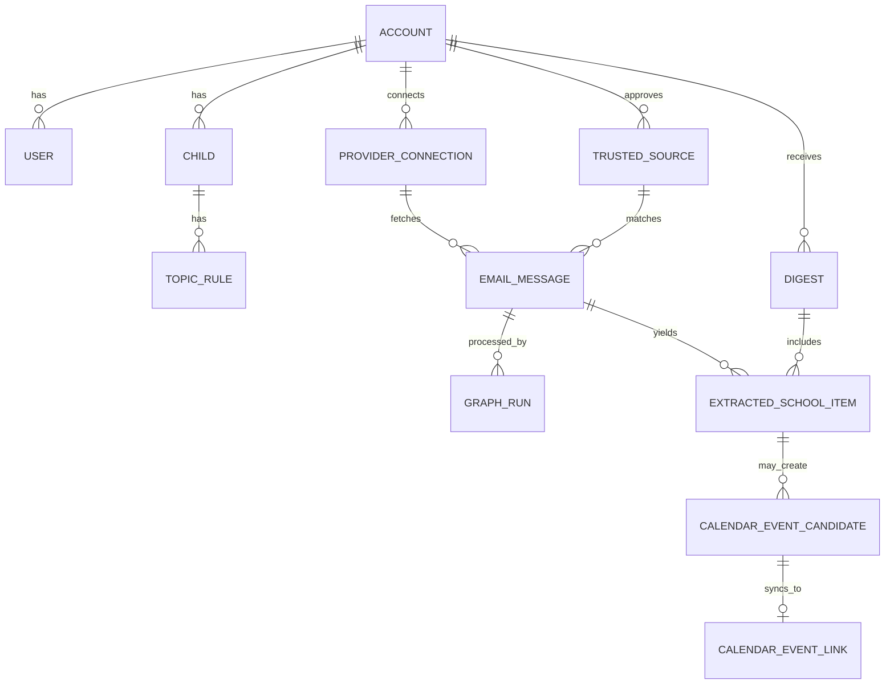

# Data Model

## Proposed Core Entities

### Account

Owns users, children, sources, provider connections, topics, and digest policy.

### User

Represents a parent or guardian who can configure sources, review candidates, and receive digests.

### Child

Represents a child-specific context.

Suggested fields:

- `id`
- `accountId`
- `displayName`
- `schoolName`
- `grade`
- `aliases`
- `active`

### Provider Connection

Represents an external email or calendar integration. Email and calendar connections should be separate so users can read from one provider and write events to another.

Suggested fields:

- `id`
- `accountId`
- `provider`
- `capability`: `EMAIL_READ` or `CALENDAR_WRITE`
- `email`
- `credentials`
- `status`
- `createdAt`
- `updatedAt`

### Trusted Source

User-approved sender or domain that the system may process.

Suggested fields:

- `id`
- `accountId`
- `providerConnectionId`
- `type`: `EMAIL_ADDRESS` or `DOMAIN`
- `value`
- `displayName`
- `status`: `SUGGESTED`, `APPROVED`, `REJECTED`, `DISABLED`
- `notes`

### Topic Rule

A natural-language preference or interest area, optionally scoped to a child.

Suggested fields:

- `id`
- `accountId`
- `childId`
- `name`
- `description`
- `includeExamples`
- `excludeExamples`
- `calendarPolicy`
- `status`

### Email Message

Stores provider-stable metadata and normalized content.

Suggested fields:

- `id`
- `accountId`
- `providerConnectionId`
- `providerMessageId`
- `threadId`
- `sourceId`
- `subject`
- `from`
- `to`
- `sentAt`
- `receivedAt`
- `textBody`
- `htmlBody`
- `contentHash`

### Graph Run

Persists one workflow execution.

Suggested fields:

- `id`
- `accountId`
- `workflowName`
- `workflowVersion`
- `status`
- `input`
- `state`
- `startedAt`
- `completedAt`
- `error`

### Extracted School Item

Structured result from a processed email.

Suggested fields:

- `id`
- `accountId`
- `emailMessageId`
- `childId`
- `topicRuleId`
- `type`: `SUMMARY`, `ACTION`, `DEADLINE`, `EVENT`
- `title`
- `summary`
- `dueAt`
- `confidence`
- `evidence`
- `status`

### Calendar Event Candidate

Validated candidate before or after calendar write.

Suggested fields:

- `id`
- `accountId`
- `emailMessageId`
- `childId`
- `topicRuleId`
- `title`
- `description`
- `location`
- `startsAt`
- `endsAt`
- `timezone`
- `allDay`
- `confidence`
- `validationStatus`
- `dedupeKey`
- `approvalStatus`

### Calendar Event Link

Maps local candidates to provider calendar events.

Suggested fields:

- `id`
- `accountId`
- `calendarConnectionId`
- `calendarEventCandidateId`
- `providerEventId`
- `status`
- `lastSyncedAt`

### Review Item

Represents something the user must decide.

Suggested fields:

- `id`
- `accountId`
- `type`
- `subjectId`
- `status`
- `decision`
- `decisionByUserId`
- `decidedAt`

### Digest

Represents a daily digest window and rendered output.

Suggested fields:

- `id`
- `accountId`
- `windowStart`
- `windowEnd`
- `status`
- `renderedSummary`
- `sentAt`

## Relationships

