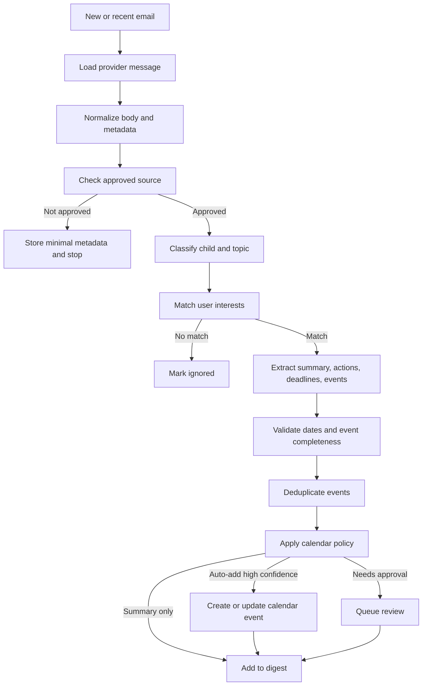
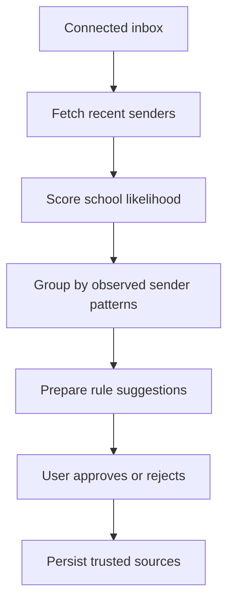
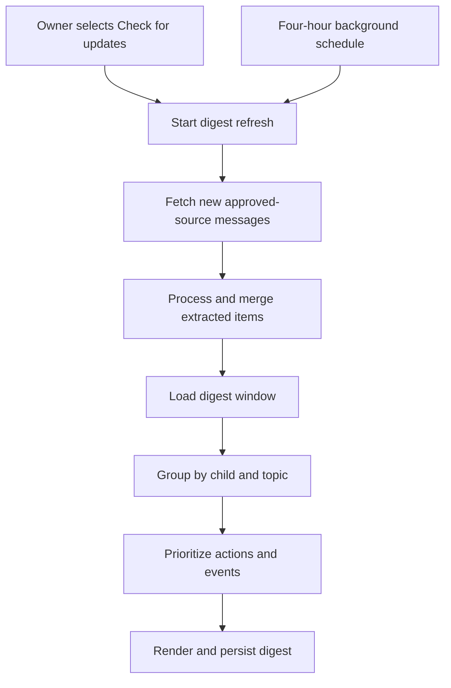

# LangGraph Workflows

## Proposal Status

Requirements discovery is paused at the [Version 0 trial snapshot](product/requirements-workshop-v0.md). The detailed processing graph, state types, and nodes below are inherited proposals, not a formal specification. Calendar policy, provider deduplication, writes, and formal event candidates are future-stage only. Digest processing must preserve undated items, uncertain relevance, and missing body details; rules below that reject such items or imply attachment analysis need reconciliation before specification. No application implementation or reusable private prototype is assumed.

## Why LangGraph

This product has a workflow with branching, retries, persisted state, human approval, and deterministic side effects. LangGraph is a better fit than an ad hoc chain because the application needs durable execution and clear control over when model output can affect calendars.

LangChain can still be used for model wrappers, prompt templates, structured output, embeddings, and document utilities.

## Email Processing Graph



## Proposed Graph State

```ts
interface SchoolEmailState {
  userId: string;
  accountId: string;
  inboxId: string;
  provider: "OUTLOOK" | "GMAIL";
  providerMessageId: string;
  threadId?: string;

  normalizedEmail?: NormalizedEmail;
  approvedSourceRule?: TrustedSourceRule;

  childMatches: ChildMatch[];
  topicMatches: TopicMatch[];
  extractedItems: ExtractedSchoolItem[];
  eventCandidates: CalendarEventCandidate[];

  validationErrors: ValidationError[];
  duplicateMatches: DuplicateEventMatch[];

  processingDecision?:
    | "IGNORE"
    | "SUMMARY_ONLY"
    | "REQUEST_APPROVAL"
    | "AUTO_ADD_EVENT"
    | "UPDATE_EXISTING_EVENT";

  digestItems: DigestItem[];
  calendarWriteResults: CalendarWriteResult[];
  audit: GraphAuditEntry[];
}
```

## Key Nodes

### Load Message

Proposes using the provider connector to fetch approved-source message details. No provider client implementation exists in this repository yet.

### Normalize Email

Proposes converting provider payloads into normalized metadata and body text. HTML normalization must be selected and validated using synthetic fixtures; no existing private utility is assumed.

### Check Approved Source Rule

Deterministic check against user-approved source rules. The first release supports exact sender-address and sender-domain rules, applied per household rather than hardcoded by school or vendor. AI should not bypass this node.

### Classify Child And Topic

Uses structured model output to identify:

- Children referenced or implied
- School context
- Topic matches
- Confidence
- Evidence spans
- Reasons for uncertainty

### Match User Interests

Deterministic policy node using model classification plus configured user preferences.

### Extract School Items

Uses structured output to extract:

- Summary
- Required actions
- Forms and deadlines
- Event candidates
- Attachments or links requiring review

Each extracted item should include evidence from the email.

### Validate Events

Deterministic validation node:

- Reject missing date or title.
- Reject ambiguous dates like "next Friday" unless the sent date resolves it confidently.
- Normalize timezone.
- Require a start time or mark as all-day.
- Preserve original source text.

### Deduplicate Events

Checks local database and calendar provider for likely duplicates by:

- Source message ID
- Prior event candidate hash
- Calendar provider event ID
- Title/date/location similarity

### Apply Calendar Policy

Routes based on source, topic, child, confidence, and user settings:

- Ignore
- Summary only
- Request approval
- Auto-add
- Update existing event

### Calendar Write

Creates or updates a provider event only after policy and validation permit it. This node should be idempotent.

### Digest Inclusion

Stores digest-ready summaries and links to source evidence, review items, and calendar write outcomes.

## Source Discovery Graph



The planned workflow should provide recent sender discovery, AI-assisted filtering, explanations, and user review rather than directly treating filtered sources as trusted.

## Digest Refresh Graph



The app should continue showing the cached digest while this workflow runs, then expose the refreshed persisted digest and check status. Email and push delivery are not part of the first release.

## Human Review

Human review is required for:

- New trusted source approval
- Low-confidence child or topic matches
- Ambiguous event dates
- First calendar writes for a topic/source
- User policies set to "ask before adding"

Human feedback should feed back into topic rules, ignore rules, and examples.

## Testing Strategy

- Unit test deterministic nodes with fixed inputs.
- Snapshot structured model schemas.
- Use fixture emails for graph-level tests.
- Mock provider connectors and calendar writers.
- Keep calendar write tests idempotent and side-effect free by default.
