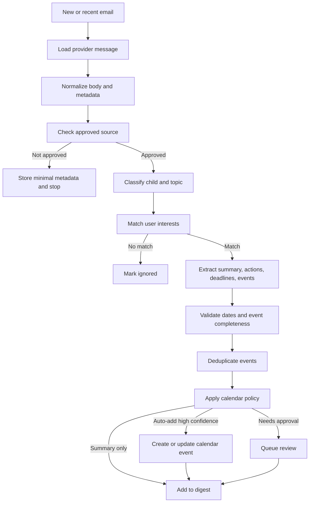
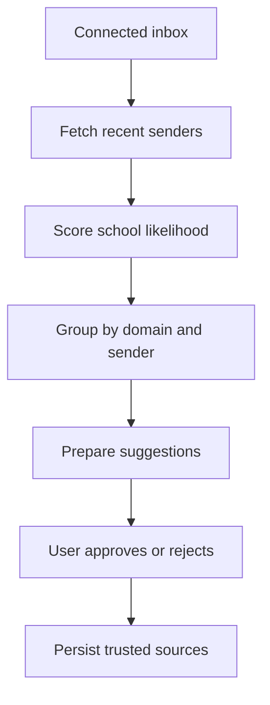
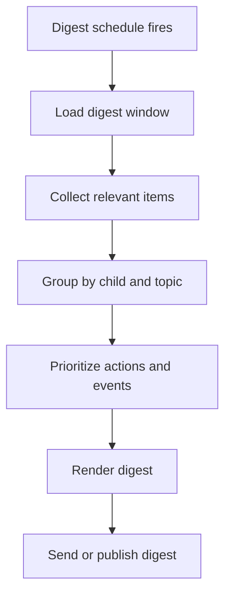

# LangGraph Workflows

## Why LangGraph

This product has a workflow with branching, retries, persisted state, human approval, and deterministic side effects. LangGraph is a better fit than an ad hoc chain because the application needs durable execution and clear control over when model output can affect calendars.

LangChain can still be used for model wrappers, prompt templates, structured output, embeddings, and document utilities.

## Email Processing Graph



## Proposed Graph State

```ts
interface SchoolEmailState {
  userId: string;
  accountId: string;
  inboxId: string;
  provider: "OUTLOOK" | "GMAIL";
  providerMessageId: string;
  threadId?: string;

  normalizedEmail?: NormalizedEmail;
  approvedSource?: TrustedSource;

  childMatches: ChildMatch[];
  topicMatches: TopicMatch[];
  extractedItems: ExtractedSchoolItem[];
  eventCandidates: CalendarEventCandidate[];

  validationErrors: ValidationError[];
  duplicateMatches: DuplicateEventMatch[];

  processingDecision?:
    | "IGNORE"
    | "SUMMARY_ONLY"
    | "REQUEST_APPROVAL"
    | "AUTO_ADD_EVENT"
    | "UPDATE_EXISTING_EVENT";

  digestItems: DigestItem[];
  calendarWriteResults: CalendarWriteResult[];
  audit: GraphAuditEntry[];
}
```

## Key Nodes

### Load Message

Uses the provider connector to fetch full message details. Existing Outlook Graph client code is a starting point.

### Normalize Email

Converts provider payloads into normalized metadata and text. The current `extractTextFromHtml` utility can be reused if it handles real school email well enough.

### Check Approved Source

Deterministic check against user-approved source addresses and domains. AI should not bypass this node.

### Classify Child And Topic

Uses structured model output to identify:

- Children referenced or implied
- School context
- Topic matches
- Confidence
- Evidence spans
- Reasons for uncertainty

### Match User Interests

Deterministic policy node using model classification plus configured user preferences.

### Extract School Items

Uses structured output to extract:

- Summary
- Required actions
- Forms and deadlines
- Event candidates
- Attachments or links requiring review

Each extracted item should include evidence from the email.

### Validate Events

Deterministic validation node:

- Reject missing date or title.
- Reject ambiguous dates like "next Friday" unless the sent date resolves it confidently.
- Normalize timezone.
- Require a start time or mark as all-day.
- Preserve original source text.

### Deduplicate Events

Checks local database and calendar provider for likely duplicates by:

- Source message ID
- Prior event candidate hash
- Calendar provider event ID
- Title/date/location similarity

### Apply Calendar Policy

Routes based on source, topic, child, confidence, and user settings:

- Ignore
- Summary only
- Request approval
- Auto-add
- Update existing event

### Calendar Write

Creates or updates a provider event only after policy and validation permit it. This node should be idempotent.

### Digest Inclusion

Stores digest-ready summaries and links to source evidence, review items, and calendar write outcomes.

## Source Discovery Graph



The current code already supports recent sender discovery and AI filtering. The new version should add explanations and user review rather than directly treating filtered sources as trusted.

## Daily Digest Graph



Digest generation can initially write a database record or API response before email/push delivery is implemented.

## Human Review

Human review is required for:

- New trusted source approval
- Low-confidence child or topic matches
- Ambiguous event dates
- First calendar writes for a topic/source
- User policies set to "ask before adding"

Human feedback should feed back into topic rules, ignore rules, and examples.

## Testing Strategy

- Unit test deterministic nodes with fixed inputs.
- Snapshot structured model schemas.
- Use fixture emails for graph-level tests.
- Mock provider connectors and calendar writers.
- Keep calendar write tests idempotent and side-effect free by default.
