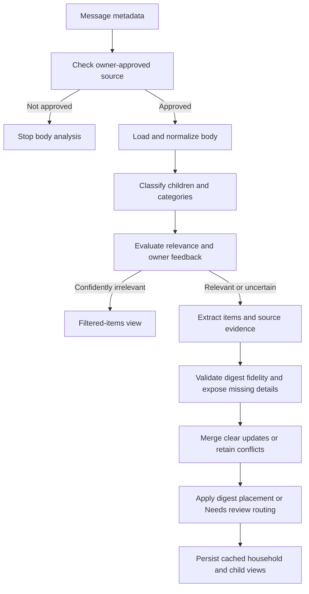
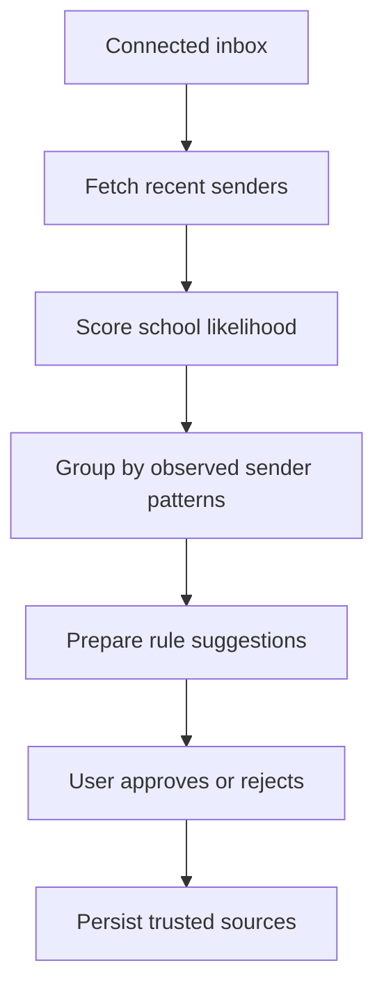
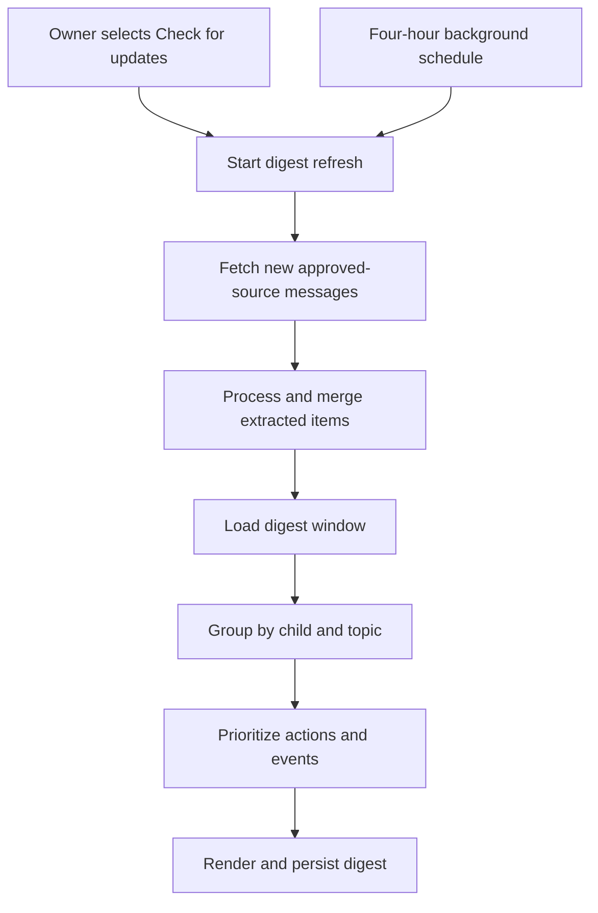

# LangGraph Workflows

## Proposal Status

Documentation reconciliation separates the digest contract from future calendar eligibility. The graph and state types are conceptual proposals, not a formal specification. Calendar candidates, policy, deduplication against calendars, and writes are future-stage only. See [R1 scenarios](product/reconciliation-scenarios.md#digest-completeness-r1) and [review status](product/requirements-workshop-v0-review.md#reconciliation-status).

## Why LangGraph

This product has a workflow with branching, retries, persisted state, human approval, and deterministic side effects. LangGraph is a better fit than an ad hoc chain because the application needs durable execution and clear control over when model output can affect calendars.

LangChain can still be used for model wrappers, prompt templates, structured output, embeddings, and document utilities.

## Email Processing Graph



The source gate precedes body analysis. Undated or incomplete items do not pass through a calendar validator to enter the digest. Review aging and ignore-rule precedence follow the confirmed [product rules](product-requirements.md#configure-children-and-topics) and [scenarios](product/reconciliation-scenarios.md#review-aging-and-precedence-r4).

## Proposed Graph State

```ts
interface SchoolEmailState {
  userId: string;
  accountId: string;
  inboxId: string;
  provider: "OUTLOOK" | "GMAIL";
  providerMessageId: string;
  threadId?: string;

  normalizedEmail?: NormalizedEmail;
  approvedSourceRule?: TrustedSourceRule;

  childMatches: ChildMatch[];
  topicMatches: TopicMatch[];
  extractedItems: ExtractedSchoolItem[];

  validationErrors: ValidationError[];
  itemMatches: ExistingItemMatch[];

  processingDecision?:
    | "IGNORE"
    | "DIGEST"
    | "NEEDS_REVIEW";

  digestItems: DigestItem[];
  audit: GraphAuditEntry[];
}
```

## Key Nodes

### Load Message

Proposes using the provider connector to fetch approved-source message details. No provider client implementation exists in this repository yet.

### Normalize Email

Proposes converting provider payloads into normalized metadata and body text. HTML normalization must be selected and validated using synthetic fixtures; no existing private utility is assumed.

### Check Approved Source Rule

Deterministic check against user-approved source rules. The first release supports exact sender-address and sender-domain rules, applied per household rather than hardcoded by school or vendor. AI should not bypass this node.

### Classify Child And Topic

Uses structured model output to identify:

- Children referenced or implied
- School context
- Topic matches
- Confidence
- Evidence spans
- Reasons for uncertainty

### Match User Interests

Deterministic policy node using model classification plus configured user preferences.

### Extract School Items

Uses structured output to extract:

- Summary
- Required actions
- Forms and deadlines
- Digest event details, including child-specific participant details
- Body references to attachments or links with specific missing details (no external content analysis)

Each extracted item should include evidence from the email.

### Validate Digest Fidelity

Deterministic checks preserve evidence and expose uncertainty rather than rejecting relevant information for missing calendar fields:

- Preserve missing dates, broad ranges, and original phrases; never invent a deadline or all-day status.
- Resolve relative phrases against the source timestamp in the household timezone; setup prefills a detected timezone for owner confirmation, and all household views use that saved timezone.
- When the source timestamp is missing or unreliable, estimate relative dates from the household-local received timestamp, preserve the original phrase, and label the result `Estimated from received date`.
- Keep specificity distinct from interpretation certainty; uncertain interpretations go to `Needs review`.
- Keep distinct child/participant times and state which details the body omits.
- Retain items referring to external instructions without reading those instructions.

### Match And Merge Digest Items

Match existing logical items using source evidence. Clear replacements update the common item and applicable child details across views; recency alone does not settle a conflict. Conflicts retain both sources in `Needs review`. Matching mechanics remain undecided.

### Digest Inclusion

Persist summaries and evidence independently of calendar eligibility. Apply the [digest display rules](product-requirements.md#date-aware-digest); confirmed range and review-aging boundaries are recorded in [scenarios](product/reconciliation-scenarios.md).

### Future Calendar Eligibility And Writes

Only a later calendar stage may create formal candidates from digest evidence. A deterministic eligibility validator must require a supported title, date, timezone, and a supported start time or explicit all-day interpretation. Missing or ambiguous fields block writing rather than removing the digest item. A missing time alone never establishes all-day semantics.

Calendar-provider deduplication, policy evaluation, approval, and idempotent writes occur after eligibility validation. Exact policies and candidate schemas remain unresolved; no v1 branch performs calendar access or writes.

## Source Discovery Graph



The planned workflow should provide recent sender discovery, AI-assisted filtering, explanations, and user review rather than directly treating filtered sources as trusted.

## Digest Refresh Graph



The app should continue showing the cached digest while this workflow runs, then expose the refreshed persisted digest and check status. Email and push delivery are not part of the first release.

## Human Review

Human review is required for:

- New trusted source approval
- Low-confidence child or topic matches
- Ambiguous event dates

Future calendar review policies (including first writes and "ask before adding") remain separate from v1 digest review.

Human feedback should feed back into topic rules, ignore rules, and examples.

## Testing Strategy

- Unit test deterministic nodes with fixed inputs.
- Snapshot structured model schemas.
- Use fixture emails for graph-level tests.
- Mock provider connectors and calendar writers.
- Keep calendar write tests idempotent and side-effect free by default.
